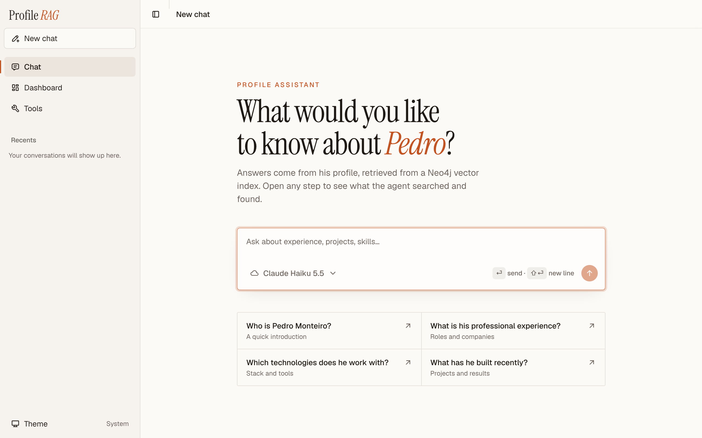
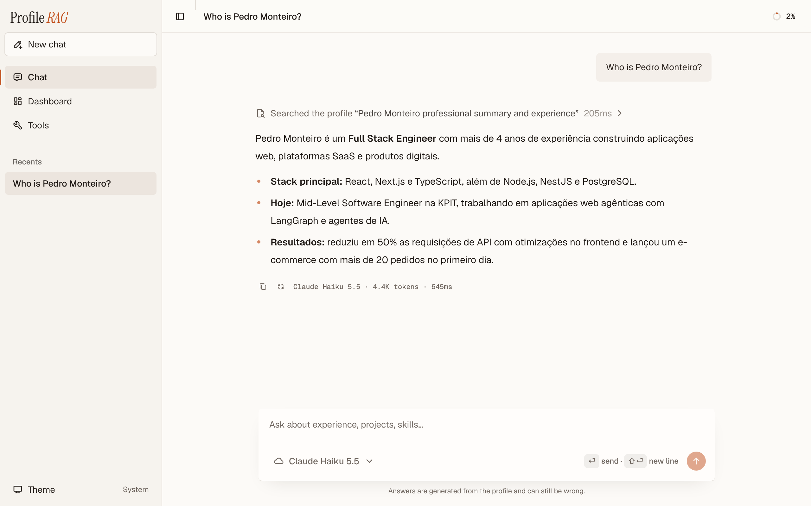
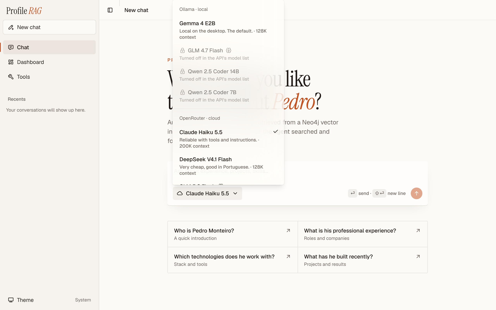
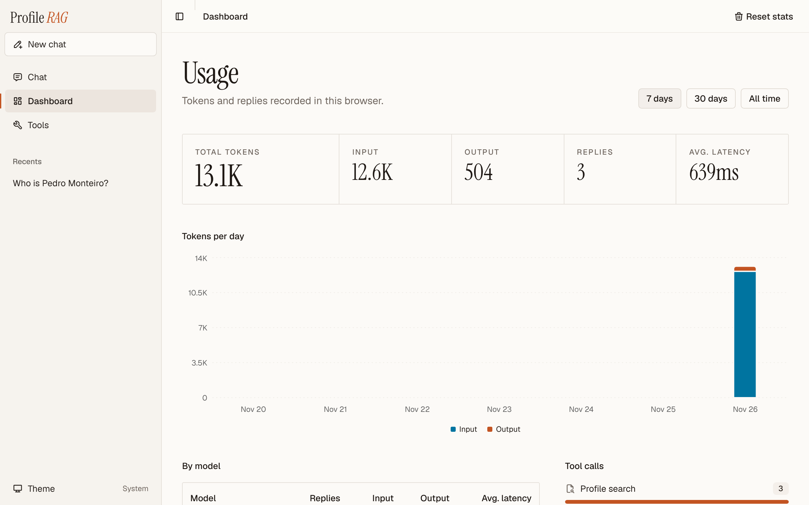
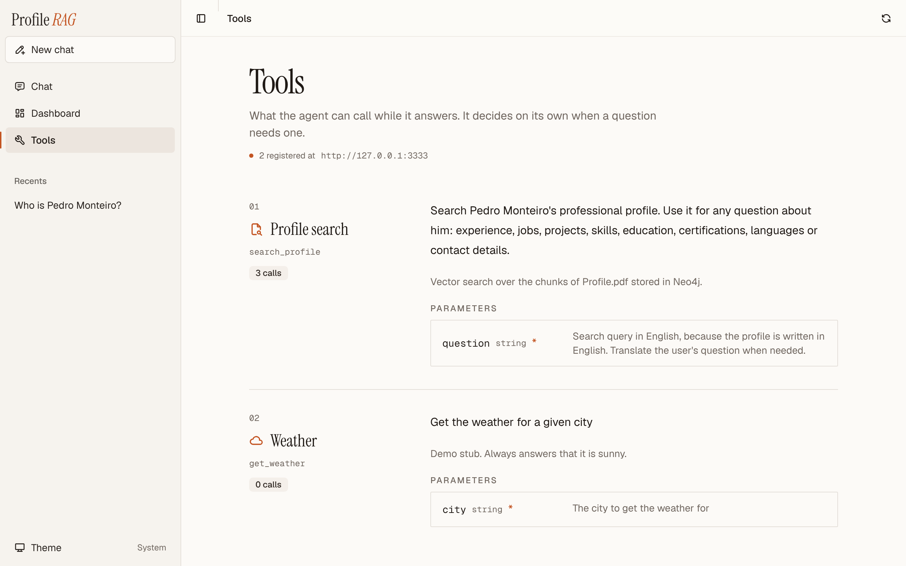
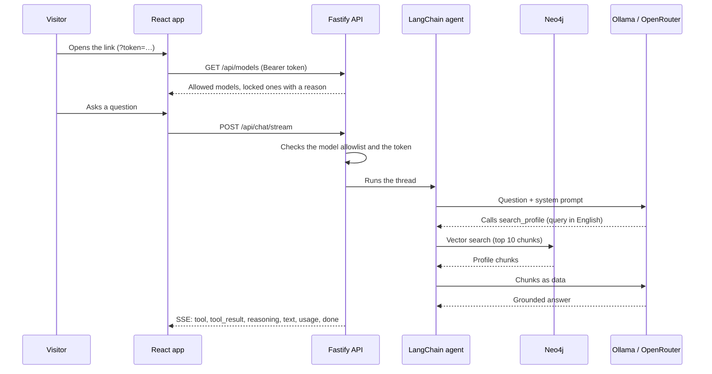

<div align="center">



# Profile RAG — Ask About Pedro

AI assistant that answers questions about my career, grounded only in my LinkedIn profile.
A LangChain agent with RAG over a Neo4j vector index, a streaming Fastify API and a React chat UI. Built for recruiters and companies, shared through private access links.


</div>

---

## Features

### For visitors

- Chat in Portuguese or English about experience, projects, skills and results
- Answers come only from the profile: the agent searches it on every question about me and says so when something is not there
- Agent steps you can open: what was searched, which chunks came back, the model's reasoning
- Model picker: local models (Ollama) or hosted ones (OpenRouter), with "think" mode where the model supports it
- Context meter, token count and latency on every reply
- Conversations kept in the browser, with retry and stop
- Friendly notice with a LinkedIn button when something fails (API down, out of credits, computer off)

### For me (the owner)

- **Private access links**: `https://rag.monteirodev.com?token=…` unlocks the paid OpenRouter models; without a valid token only the local Ollama models work
- One token per person, so a single link can be revoked
- Model allowlist in one file: the API rejects any model not on it
- OpenRouter details (name, context window, reasoning support) fetched live from its catalog
- Usage dashboard: tokens per day, per model, latency and tool calls
- Tools page listing every tool the agent can call, with its JSON schema
- Terminal chat for quick tests

## Screenshots

| Answer with agent steps | Model picker |
| :---: | :---: |
|  |  |
| **Usage dashboard** | **Agent tools** |
|  |  |

## Tech stack

| Layer | Technologies |
| --- | --- |
| Agent | LangChain 1 + LangGraph (`createAgent`, `MemorySaver`), tool calling, Zod tool schemas |
| LLMs | Ollama (local) and OpenRouter (hosted, OpenAI-compatible) via `@langchain/ollama` and `@langchain/openai` |
| RAG | Neo4j 5 vector index, local embeddings with Transformers.js (`all-MiniLM-L6-v2`), `pdf-parse` + recursive text splitter |
| API | Fastify 5, Server-Sent Events, `@fastify/cors`, Zod-validated env |
| Web | React 19, Vite 8, TypeScript, Tailwind CSS 4, shadcn/ui on Radix, Motion, Recharts, react-markdown |
| Runtime | Node.js running TypeScript directly (type stripping, no build step for the API) |
| Quality | `node:test`, `tsc --noEmit`, ESLint and Prettier on the web |
| Infra | Docker Compose (Neo4j + APOC) |

## Architecture

Each part has its own README with its stack, flow and decisions: [**API**](api/README.md) (agent, RAG, streaming) and [**Web**](web/README.md) (chat UI).

```
my-profile-rag/
  api/                    # agent, RAG and HTTP API (npm)
    data/Profile.pdf      # the source of truth: LinkedIn profile export
    src/
      cli/                # entry points: seed, chat (terminal), api (HTTP)
      agent/              # agent, system prompt, stream → reply events
      rag/                # PDF loading, ingestion, retriever
      tools/              # search_profile (and a stub get_weather)
      api/                # Fastify app, access tokens
      infra/              # chat model, embeddings, vector store, model catalog
      config/             # lazy env parsing, tunables, model allowlist
    test/
  web/                    # chat UI (pnpm)
    src/
      features/chat/      # chat store, composer, model picker, agent steps
      features/dashboard/ # usage stats
      features/tools/     # tool list
      lib/                # API client, SSE reader, access token
      config/             # provider labels, contact link
  docs/media/             # README screenshots
```

### How a question is answered



Key decisions:

- **Grounded by design**: the system prompt forces a profile search before answering and treats retrieved chunks as data, never as instructions.
- **Language split**: the prompt is in Portuguese and replies follow the visitor's language; the profile is in English, so the tool tells the model to search in English.
- **The model is chosen per request**: one agent per model shares a single memory, so a conversation keeps its history when the visitor switches models.
- **Paid models stay behind a token**: the token is checked on the server for every request, compared in constant time, and stripped from the address bar once saved.
- **Errors never leak details**: the visitor sees a generic message; only known, safe messages (like a missing model) are passed through.
- **Testable without infrastructure**: the API receives the reply streamer as an argument, so tests run without Neo4j or an LLM.

## Running locally

Requirements: Node.js 22+, npm, pnpm, Docker and [Ollama](https://ollama.com) (or an OpenRouter key).

```bash
# API
cd api
npm install
cp .env.example .env     # set NEO4J_PASSWORD="password"
npm run infra:up         # start Neo4j (Bolt 7688, Browser 7475)
npm run seed             # ingest data/Profile.pdf
npm run api              # http://127.0.0.1:3333
```

```bash
# Web
cd web
pnpm install
pnpm dev                 # http://localhost:5173
```

With the default provider, pull the Ollama model first (`ollama pull gemma4:e2b`). For the terminal chat, run `npm run chat` in `api/`.

To try the hosted models locally, set `OPENROUTER_API_KEY` and `ACCESS_TOKENS="dev"`, then open `http://localhost:5173/?token=dev`.

### Environment variables

API — see [`api/.env.example`](api/.env.example):

| Variable | What it does |
| --- | --- |
| `LLM_PROVIDER` | Default provider when a request names no model (`ollama` or `openrouter`) |
| `OLLAMA_MODEL`, `OLLAMA_URL` | Local model and Ollama address |
| `OPENROUTER_API_KEY`, `NLP_MODEL` | OpenRouter key and default hosted model |
| `ACCESS_TOKENS` | Comma-separated tokens that unlock OpenRouter; empty locks it for everyone |
| `EMBEDDING_MODEL` | Embedding model (runs locally) |
| `NEO4J_URI`, `NEO4J_USER`, `NEO4J_PASSWORD` | Neo4j connection |
| `API_HOST`, `API_PORT`, `CORS_ORIGIN` | Where the API listens and who may call it |

Web: `VITE_API_URL` points to the API (defaults to `http://127.0.0.1:3333`).

### Choosing the models

The picker lists exactly what [`api/src/config/models.ts`](api/src/config/models.ts) declares. Add an OpenRouter model by its slug; set `enabled: false` to show it locked. A slug OpenRouter does not list shows up as locked, so a typo is visible right away.

## Scripts

API (`api/`, npm):

| Command | What it does |
| --- | --- |
| `npm run infra:up` / `npm run infra:down` | Start/stop Neo4j |
| `npm run seed` | Load, split and index the profile PDF |
| `npm run api` | Start the streaming API |
| `npm run chat` | Terminal chat (`/clear`, `/exit`) |
| `npm test` | Tests with `node:test` |
| `npm run typecheck` | Type checking |

Web (`web/`, pnpm):

| Command | What it does |
| --- | --- |
| `pnpm dev` | Development server |
| `pnpm build` / `pnpm preview` | Production build and preview |
| `pnpm lint` / `pnpm format` | ESLint and Prettier |
| `pnpm typecheck` | Type checking |

## API

| Endpoint | What it does |
| --- | --- |
| `POST /api/chat/stream` | `{ message, threadId?, model?: { provider, model, think? } }` → SSE: `start`, `tool`, `tool_input`, `tool_result`, `reasoning`, `text`, `usage`, then `done` or `error` |
| `GET /api/models` | Allowed models, each with `available` and an `unavailableReason` (`disabled`, `token_required`, `missing_api_key`, `not_on_openrouter`, `ollama_offline`) |
| `GET /api/tools` | The agent's tools with their JSON schema |

Send `Authorization: Bearer <token>` to unlock the OpenRouter models.

---

<div align="center">

Built by [Pedro Monteiro](https://github.com/opedro-monteiro) · [LinkedIn](https://www.linkedin.com/in/opedro-monteiro)

</div>
