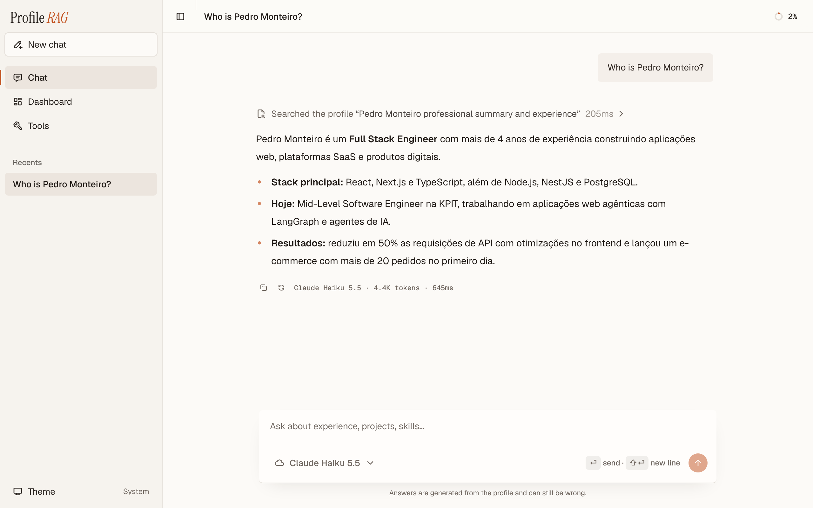
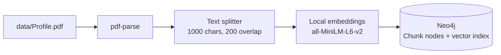
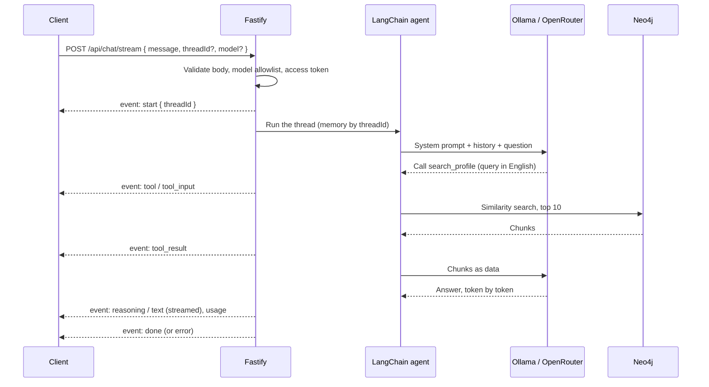

<div align="center">



# Profile RAG — API

Backend of [Profile RAG](../README.md): a LangChain agent that answers questions about Pedro Monteiro using only his LinkedIn profile.
It ingests the profile PDF into a Neo4j vector index and serves the agent through a streaming Fastify API and a terminal chat.


</div>

---

## What it does

- **Ingests the profile**: loads `data/Profile.pdf`, splits it into overlapping chunks, embeds them locally and stores them in Neo4j
- **Answers with an agent**: the model calls the `search_profile` tool, gets the closest chunks and answers only from them
- **Streams every step**: tool calls, tool inputs and results, reasoning, text and token usage go to the client as Server-Sent Events
- **Runs on two providers**: Ollama on the local machine or OpenRouter in the cloud, chosen per request
- **Keeps paid models private**: OpenRouter only works for requests that carry a valid access token
- **Allows only listed models**: one file lists the models; requests for any other model are rejected
- **Checks what is up**: pings Ollama and reads OpenRouter's live catalog, so the client knows which models it can use right now
- **Has a terminal chat** for quick tests, with `/clear` and `/exit`

## Tech stack

| Layer | Technologies |
| --- | --- |
| Agent | LangChain 1 (`createAgent`), LangGraph `MemorySaver` for conversation threads |
| Models | `@langchain/ollama` (`ChatOllama`), `@langchain/openai` (`ChatOpenAI` pointed at OpenRouter) |
| Tools | Zod schemas, exported as JSON Schema by `GET /api/tools` |
| Retrieval | Neo4j 5 vector index via `@langchain/neo4j`, top 10 chunks per query |
| Embeddings | Transformers.js (`@huggingface/transformers`), `Xenova/all-MiniLM-L6-v2`, run locally |
| Ingestion | `pdf-parse`, `@langchain/textsplitters` (1000 characters, 200 overlap), batches of 16 |
| HTTP | Fastify 5, `@fastify/cors`, JSON Schema body validation, SSE through a Node stream |
| Config | Zod-validated env, parsed lazily on first use |
| Runtime | Node.js running TypeScript directly (type stripping): no build step |
| Tests | `node:test` with Fastify `inject`, no Neo4j or LLM needed |
| Infra | Docker Compose: Neo4j 5.14 Community with APOC |

## Architecture

```
api/
  data/Profile.pdf        # the only source of facts
  docker-compose.yml      # Neo4j (Bolt 7688, Browser 7475)
  src/
    cli/
      seed.ts             # ingest the PDF
      chat.ts             # terminal chat
      api.ts              # HTTP server: wires catalog, access check, agent pool
      fatal-error.ts      # human-readable startup errors (Neo4j down, no index...)
    agent/
      assistant.ts        # createAgent + one agent per model, sharing one memory
      system-prompt.ts    # grounding rules (Portuguese)
      stream-reply.ts     # agent stream → tool / tool_input / tool_result / reasoning / text / usage
    rag/
      document-loader.ts  # PDF → documents
      ingest.ts           # split, delete old chunks, insert in batches
      retriever.ts        # similarity search + context formatting
    tools/
      search-profile.ts   # the tool the agent uses for every question about Pedro
      get-weather.ts      # stub, always sunny
    api/
      app.ts              # routes, validation, SSE, error handling
      access.ts           # bearer token check (constant-time)
    infra/
      chat-model.ts       # Ollama / OpenRouter model factory
      embeddings.ts       # local embedding model
      vector-store.ts     # Neo4j vector store singleton
      model-catalog.ts    # model list + OpenRouter catalog + Ollama health
    config/
      env.ts              # Zod env schema
      index.ts            # getConfig(): env + tunables (chunking, topK, index name)
      models.ts           # the model allowlist
  test/
```

### Ingestion



`npm run seed` deletes every `Chunk` node and inserts the new ones, so re-seeding never duplicates data. The vector index itself is kept.

### A chat request



If the client disconnects, the agent run is aborted.

### Key decisions

- **Grounding lives in the system prompt** (`agent/system-prompt.ts`): search before answering, answer only from what came back, say when something is not in the profile, and treat chunks as data, never as instructions.
- **Portuguese prompt, English profile**: replies follow the user's language, and the `search_profile` schema tells the model to write its query in English to match the profile.
- **`minScore` is 0 on purpose**: measured scores did not separate relevant from unrelated chunks, so a higher floor dropped real answers. Recalibrate if the embedding model changes.
- **The model is picked per request**: `createAssistantPool()` keeps one agent per provider/model/think, all on one `MemorySaver`, so a thread keeps its history across model switches.
- **OpenRouter needs a token**: `ACCESS_TOKENS` lists the valid ones. Without one, `/api/models` marks OpenRouter models `token_required` and the chat answers 403, including when OpenRouter is the env default. No tokens configured means nobody can use it.
- **Errors stay generic**: the client gets "Erro ao gerar a resposta."; only `ModelUnavailableError` and validation messages pass through.
- **Config is lazy**: `getConfig()` is the only reader of `process.env`, so modules can be imported in tests without any env.
- **`buildApp` takes its dependencies**: the reply streamer, model catalog and access check are arguments, so the HTTP layer is tested without Neo4j or a model.
- **Memory is in-process**: threads live in `MemorySaver` and are lost on restart.

## Running

Requirements: Node.js 22+, Docker and [Ollama](https://ollama.com) with the model pulled (or an OpenRouter key).

```bash
npm install
cp .env.example .env     # set NEO4J_PASSWORD="password" (matches docker-compose.yml)
npm run infra:up         # start Neo4j and wait until healthy
npm run seed             # ingest data/Profile.pdf
npm run api              # http://127.0.0.1:3333
```

Or chat in the terminal with `npm run chat`.

`.npmrc` sets `legacy-peer-deps=true`, which the install relies on. Neo4j data is a bind mount in `./neo4j/`; delete that folder for a clean database.

### Environment variables

See [`.env.example`](.env.example).

| Variable | Default | What it does |
| --- | --- | --- |
| `LLM_PROVIDER` | `ollama` | Provider used when a request names no model |
| `OLLAMA_MODEL`, `OLLAMA_URL` | `glm-4.7-flash:latest`, `http://localhost:11434` | Local model and Ollama address |
| `OPENROUTER_API_KEY`, `NLP_MODEL` | — | OpenRouter key and default hosted model (both required when `LLM_PROVIDER=openrouter`) |
| `OPENROUTER_SITE_URL`, `OPENROUTER_SITE_NAME` | — | Optional attribution headers for OpenRouter |
| `ACCESS_TOKENS` | empty | Comma-separated tokens that unlock OpenRouter |
| `EMBEDDING_MODEL` | — | Embedding model, e.g. `Xenova/all-MiniLM-L6-v2` |
| `NEO4J_URI`, `NEO4J_USER`, `NEO4J_PASSWORD` | — | Neo4j connection |
| `API_HOST`, `API_PORT`, `CORS_ORIGIN` | `127.0.0.1`, `3333`, `*` | Where the API listens and who may call it |

### Choosing the models

Edit [`src/config/models.ts`](src/config/models.ts):

```ts
{ provider: "openrouter", id: "anthropic/claude-haiku-5.5", description: "Reliable with tools." },
{ provider: "ollama", id: "gemma4:e2b", label: "Gemma 4 E2B", contextWindow: 128_000 },
{ provider: "ollama", id: "qwen2.5-coder:7b", label: "Qwen 2.5 Coder 7B", contextWindow: 32_000, enabled: false },
```

OpenRouter entries get their name, context window and reasoning support from OpenRouter's catalog (cached for an hour). A slug OpenRouter does not list comes back locked as `not_on_openrouter`.

## API reference

### `POST /api/chat/stream`

```json
{ "message": "Who is Pedro?", "threadId": "uuid (optional)", "model": { "provider": "openrouter", "model": "anthropic/claude-haiku-5.5", "think": false } }
```

Answers with `text/event-stream`:

| Event | Data |
| --- | --- |
| `start` | `{ threadId }` — send it back to continue the conversation |
| `tool` | `{ id, name }` |
| `tool_input` | `{ id, name, input }` |
| `tool_result` | `{ id, name, output, status }` |
| `reasoning` | `{ text }` (with `think: true`) |
| `text` | `{ text }` |
| `usage` | `{ inputTokens, outputTokens, totalTokens }` |
| `done` / `error` | `{}` / `{ message }` |

Status codes: `400` for an invalid body or a model not on the list, `403` for OpenRouter without a valid token.

### `GET /api/models`

```json
{
  "models": [{ "provider": "openrouter", "id": "...", "label": "...", "description": "...", "contextWindow": 200000, "supportsThinking": false, "available": false, "unavailableReason": "token_required" }],
  "default": { "provider": "ollama", "model": "gemma4:e2b" },
  "access": "local"
}
```

`unavailableReason` is one of `disabled`, `token_required`, `missing_api_key`, `not_on_openrouter`, `ollama_offline`.

### `GET /api/tools`

The agent's tools with name, description and JSON Schema parameters.

Send `Authorization: Bearer <token>` on `/api/models` and `/api/chat/stream` to unlock OpenRouter.

## Scripts

| Command | What it does |
| --- | --- |
| `npm run infra:up` / `npm run infra:down` | Start/stop Neo4j |
| `npm run seed` | Ingest the profile PDF |
| `npm run api` | Start the API |
| `npm run chat` | Terminal chat |
| `npm test` | All tests (`node --test test/*.test.ts`) |
| `npm run typecheck` | `tsc --noEmit` |

TypeScript runs directly on Node, so `erasableSyntaxOnly` rules out enums and constructor parameter properties, and relative imports use the `.ts` extension.

---

<div align="center">

Part of [Profile RAG](../README.md) · Built by [Pedro Monteiro](https://github.com/opedro-monteiro)

</div>
