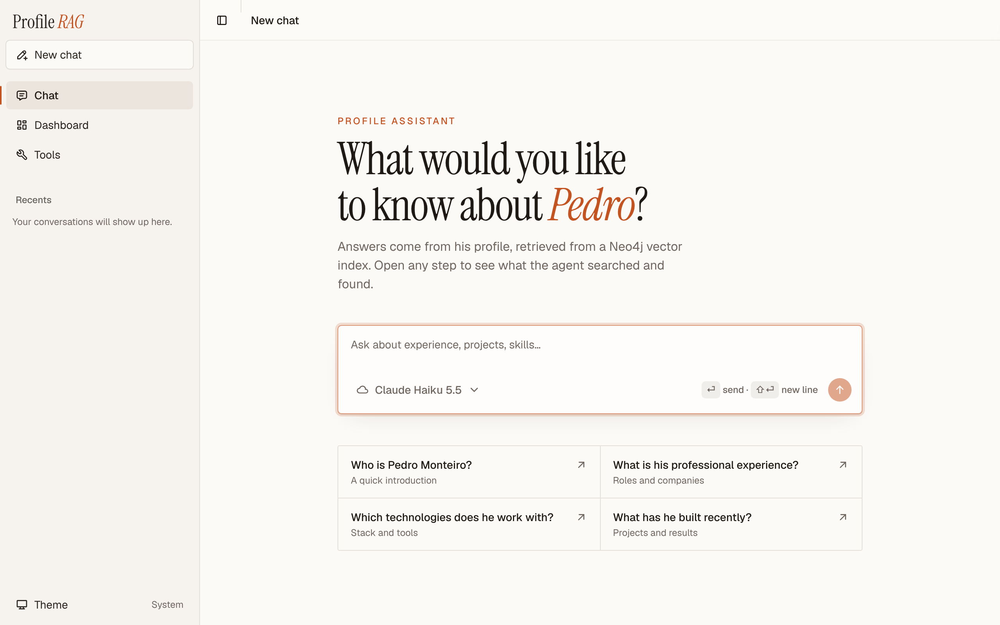
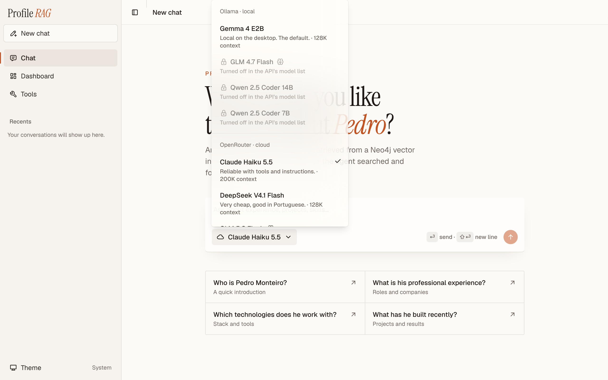
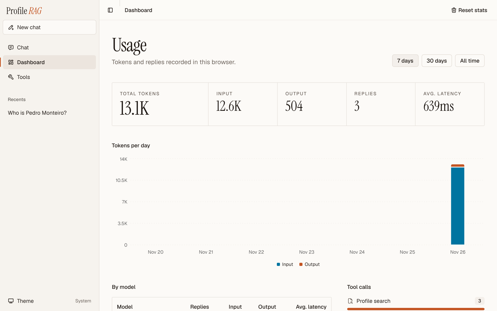
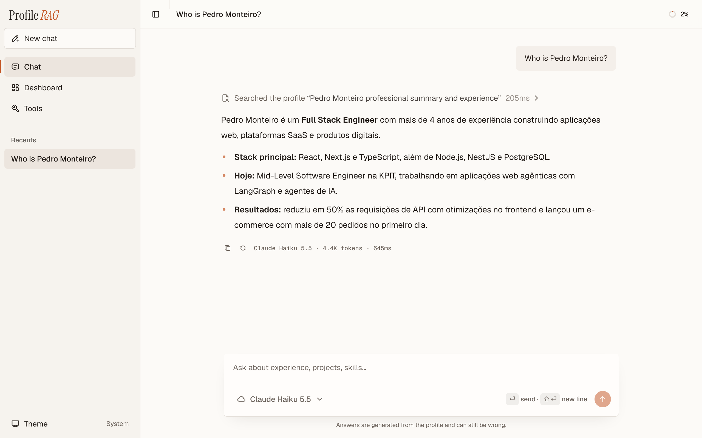
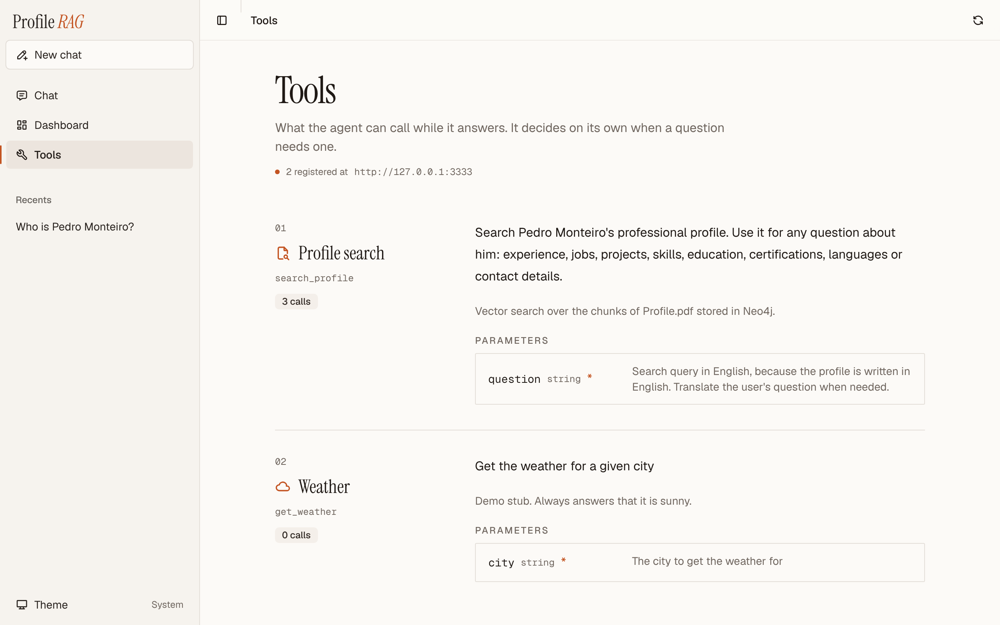
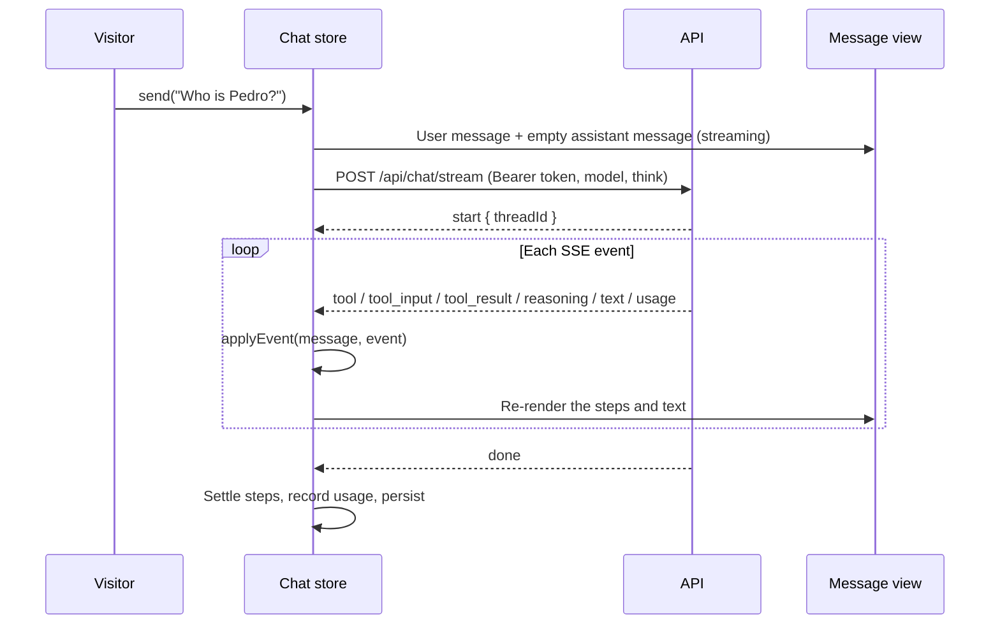

<div align="center">



# Profile RAG — Web

Chat interface of [Profile RAG](../README.md), where recruiters and companies ask questions about Pedro Monteiro.
It streams the agent's answer live, shows each step the agent took, and lets the visitor pick the model.


</div>

---

## What it does

- **Streams the answer**: reads the API's Server-Sent Events and renders text as it arrives, in Markdown with highlighted code
- **Shows the agent's work**: each tool call opens to show the query, the profile chunks that came back and the model's reasoning
- **Lets the visitor pick the model**: the picker loads the list from the API, groups it by provider and shows why a locked model is unavailable
- **Think mode** for models that support reasoning
- **Reads private links**: `?token=…` in the URL is saved, removed from the address bar and sent on every API call, which unlocks the OpenRouter models
- **Context meter**: how much of the model's context window the conversation uses
- **Usage dashboard**: tokens per day, per model, latency and tool calls, over 7 days, 30 days or all time
- **Tools page**: every tool the agent can call, with its parameters
- **Conversations stay in the browser**, with retry, stop and delete
- **One failure notice**: if the API, the model or Pedro's computer is down, the visitor sees "Acabaram os créditos do Pedro" with a button to his LinkedIn
- Light, dark and system themes; works from phone width up

## Screenshots

| Model picker | Usage dashboard |
| :---: | :---: |
|  |  |
| **Answer with agent steps** | **Agent tools** |
|  |  |

## Tech stack

| Layer | Technologies |
| --- | --- |
| Framework | React 19, TypeScript, Vite 8 |
| UI | Tailwind CSS 4, shadcn/ui on Radix UI, Tabler icons, Sonner |
| Motion | Motion (`motion/react`) with shared duration and easing tokens |
| Content | react-markdown + remark-gfm, Shiki for code blocks |
| Charts | Recharts |
| Type | Geist, Geist Mono, Instrument Serif (Fontsource) |
| State | React context (`ChatStoreProvider`) + `localStorage`, no state library |
| Routing | Hash routes (`#/chat`, `#/chat/<id>`, `#/dashboard`, `#/tools`) |
| Quality | ESLint, Prettier (with the Tailwind plugin), `tsc --noEmit` |

## Architecture

```
web/src/
  main.tsx                   # captures ?token=, mounts the app
  App.tsx                    # layout + hash routing
  config/
    models.ts                # model types, provider labels, locked-reason text
    contact.ts               # LinkedIn link used by the failure notice
  lib/
    api.ts                   # fetchModels, fetchTools, postChatStream
    sse.ts                   # parses a fetch body as Server-Sent Events
    access.ts                # reads, saves and sends the access token
    storage.ts               # safe localStorage read/write
    highlighter.tsx          # lazy Shiki loader
    format.ts, motion.ts     # number/duration formatting, motion tokens
  features/
    chat/
      chat-store.tsx         # conversations, streaming, usage, model preference
      use-models.ts          # loads GET /api/models
      apply-event.ts         # folds each SSE event into the assistant message
      chat-view.tsx          # empty state, thread, header
      composer.tsx           # input, model picker, think toggle, send/stop
      model-selector.tsx     # grouped picker with locked reasons
      agent-steps.tsx        # collapsible tool calls and reasoning
      message-item.tsx       # bubbles, footer (model, tokens, latency), retry
      context-meter.tsx      # context window usage
      out-of-credits-notice.tsx
    dashboard/               # usage stats and charts
    tools/                   # tool list from GET /api/tools
  components/
    layout/                  # sidebar, page header
    ui/                      # shadcn/ui components
  hooks/                     # hash route, highlighted code, mobile breakpoint
```

### How a message flows



Stopping aborts the request; the API sees the disconnect and stops the agent. A reload in the middle of a stream marks that reply as stopped.

### Key decisions

- **The API owns the model list**: the web has no hard-coded models. It shows what `GET /api/models` returns and keeps the visitor's last choice, falling back to the API's default or the first available model.
- **A locked model says why**: turned off, needs the access link, missing API key, not on OpenRouter, or Pedro's computer is offline.
- **The token never stays in the URL**: it is moved to `localStorage` on load, so a copied link does not carry it.
- **Everything lives in one store**: conversations, usage records and preferences are React state, written to `localStorage` (conversations with a short debounce).
- **The thread id comes from the API**: the `start` event gives it, and later messages send it back so the agent keeps the conversation.
- **Any failure shows the same notice**: a reply that fails, the API being down, or no model available.

## Running

Requirements: Node.js 22+ and pnpm. The [API](../api/README.md) must be running.

```bash
pnpm install
pnpm dev                 # http://localhost:5173
```

To see the OpenRouter models locally, set `ACCESS_TOKENS="dev"` in the API and open `http://localhost:5173/?token=dev`.

### Environment variables

| Variable | Default | What it does |
| --- | --- | --- |
| `VITE_API_URL` | `http://127.0.0.1:3333` | Where the API is |

### Browser storage

| Key | What it holds |
| --- | --- |
| `profile-rag:conversations` | Conversations and messages |
| `profile-rag:usage` | One record per reply, for the dashboard |
| `profile-rag:preferences` | Chosen model and think mode |
| `profile-rag:access-token` | The token from the shared link |

## Scripts

| Command | What it does |
| --- | --- |
| `pnpm dev` | Development server |
| `pnpm build` / `pnpm preview` | Production build and preview |
| `pnpm lint` | ESLint |
| `pnpm format` | Prettier |
| `pnpm typecheck` | `tsc --noEmit` |

Add a shadcn/ui component with `pnpm dlx shadcn@latest add <component>`; it lands in `src/components/ui`.

---

<div align="center">

Part of [Profile RAG](../README.md) · Built by [Pedro Monteiro](https://github.com/opedro-monteiro)

</div>
